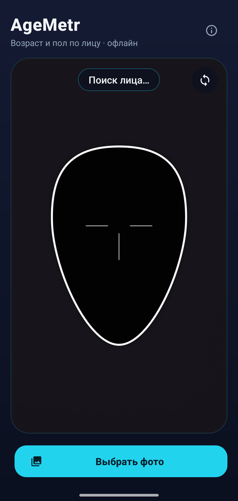
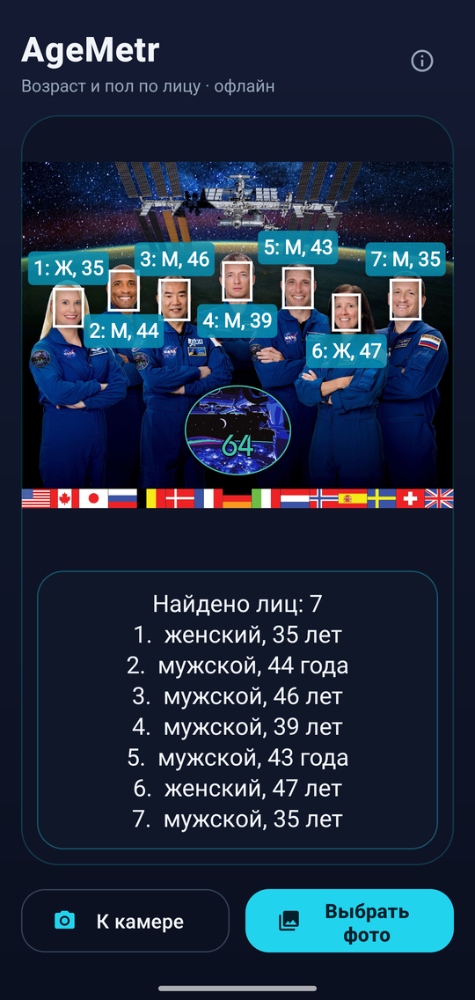
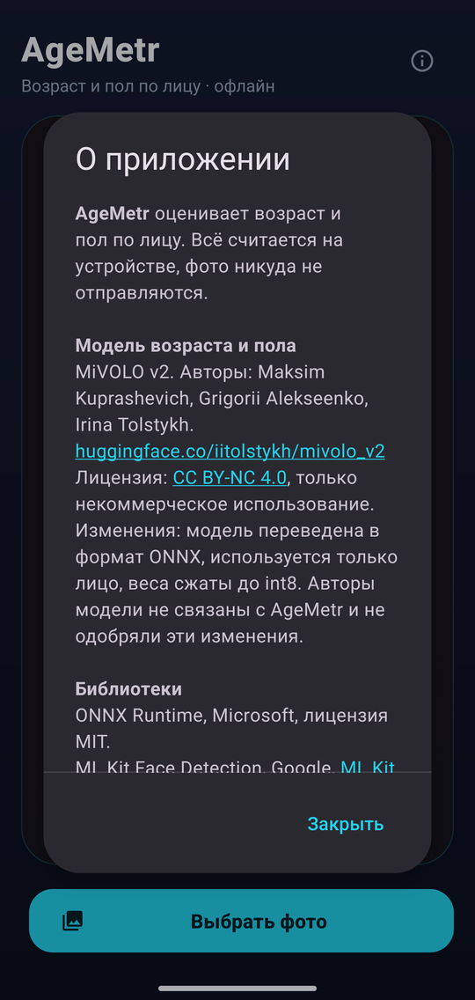

# AgeMetr

**English** · [Русский](README.ru.md)

An Android app that estimates **age and gender from a face** — live from the camera or from a photo. Everything runs on the phone: no internet connection is needed and no photos ever leave the device.

<p align="center">
  
  &nbsp;
  
  &nbsp;
  
</p>

<p align="center"><sub>Left to right: live camera, group photo analysis, About dialog (the app UI is in Russian).<br>
The photo in the middle screenshot is the official Expedition 64 crew portrait by NASA/Cindy Bush, public domain.</sub></p>

## Download

**[⬇ Download the latest APK](https://github.com/sergiusmotodroid/AgeMetr/releases/latest)** — open the link on your phone, download the `.apk` file and install it. Android may ask you to allow installing apps from this source.

Requires Android 9.0 or newer on a 64-bit ARM phone (practically any phone from the last several years).

## Features

- **Live camera.** Point the camera at a face so it fits the face guide. The app waits until the face holds still, takes three measurements and shows the result: age, gender and the model's confidence. The frame with the result is frozen; “Переснять” (Retake) starts over.
- **Front and back camera** — switch with the button in the corner.
- **Photos from the gallery.** Finds every face in a picture, numbers them left to right and labels each with age and gender — works for group photos.
- **Fully offline.** The models are bundled with the app, nothing is downloaded on first launch. The only permission is the camera.

## Key specs

| | |
|---|---|
| Age & gender model | [MiVOLO v2](https://huggingface.co/iitolstykh/mivolo_v2), face-only variant |
| Model format | ONNX, int8-quantized weights, about 42 MB |
| Model input | 384×384 RGB face crop |
| Output | age (1–100 years), gender and gender confidence |
| Accuracy after quantization | mean absolute age error 4.2 years, gender 115 of 115 (115 photos from APPA-REAL) |
| Face detection | Google ML Kit Face Detection, bundled offline model |
| Live mode | median age over 3 frames, majority vote for gender; the face must be near the center, at least 72 px wide, and hold still |
| Photo mode | accurate face detection, finds faces down to 3 % of the image size; large photos are scaled to 1800 px on the long side |
| Android | 9.0+ (minSdk 28), targetSdk 37 |
| CPU | arm64-v8a (phones), x86_64 (emulator) |
| Built with | Kotlin, CameraX 1.6, ML Kit, ONNX Runtime 1.31 |

Age is estimated from appearance, not from documents: lighting, angle, make-up and so on affect the result, and an error of a few years is normal.

## Building from source

1. Open the project folder in Android Studio.
2. Connect a phone with USB debugging enabled, or start an emulator.
3. Press **Run**.

Or from the command line:

```bash
./gradlew assembleDebug
```

The APKs are written to `app/build/outputs/apk/debug/`.

## Authors and licenses

- App code: sergiusmotodroid.
- Age and gender model: [MiVOLO v2](https://huggingface.co/iitolstykh/mivolo_v2) by Maksim Kuprashevich, Grigorii Alekseenko and Irina Tolstykh, licensed under [CC BY-NC 4.0](https://creativecommons.org/licenses/by-nc/4.0/). For AgeMetr the model was converted to ONNX and quantized to int8.
- **Non-commercial use only**, because of the model license.

All third-party components and their licenses are listed in [NOTICE.md](NOTICE.md); model details are in `app/src/main/assets/MODEL_NOTICE.txt`. The same information is shown inside the app, in the About dialog (the ⓘ button).
