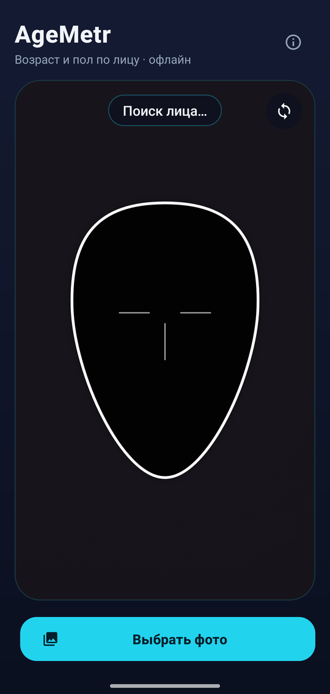
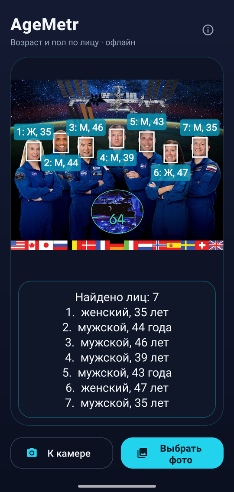
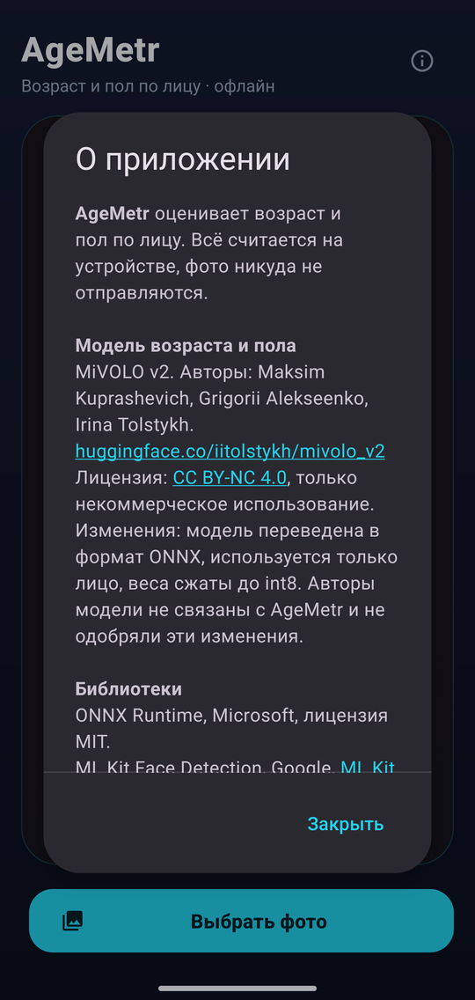

# AgeMetr

[English](README.md) · **Русский**

Android-приложение, которое оценивает **возраст и пол по лицу** — с камеры или по фотографии. Всё считается прямо на телефоне: интернет не нужен, фото никуда не отправляются.

<p align="center">
  
  &nbsp;
  
  &nbsp;
  
</p>

<p align="center"><sub>Слева направо: живая камера, разбор группового фото, окно «О приложении».<br>
Фото на среднем скриншоте — официальный портрет экипажа МКС-64, NASA/Cindy Bush, общественное достояние.</sub></p>

## Скачать

**[⬇ Скачать последнюю версию APK](https://github.com/sergiusmotodroid/AgeMetr/releases/latest)** — откройте ссылку на телефоне, скачайте файл `.apk` и установите его. Android может попросить разрешить установку приложений из этого источника.

Нужен Android 9.0 или новее на 64-битном ARM-телефоне — это практически любой телефон последних лет.

## Возможности

- **Живая камера.** Наведите камеру на лицо так, чтобы оно попало в рамку-подсказку. Приложение само дождётся, пока лицо замрёт, сделает три замера и покажет итог: возраст, пол и уверенность модели. Кадр с результатом «замораживается», кнопка «Переснять» запускает замер заново.
- **Передняя и задняя камера** — переключаются кнопкой в углу экрана.
- **Фото из галереи.** Находит на снимке все лица, нумерует их слева направо и подписывает возраст и пол каждого — подходит для групповых фото.
- **Полностью офлайн.** Модели встроены в приложение, ничего не скачивается при первом запуске. Приложению нужно только разрешение на камеру.

## Основные параметры

| Параметр | Значение |
|---|---|
| Модель возраста и пола | [MiVOLO v2](https://huggingface.co/iitolstykh/mivolo_v2), вариант «только лицо» |
| Формат модели | ONNX, веса сжаты до int8, около 42 МБ |
| Вход модели | лицо 384×384 пикселя, RGB |
| Что выдаёт | возраст (1–100 лет), пол и уверенность в поле |
| Точность после сжатия | средняя ошибка возраста 4,2 года, пол — 115 из 115 (проверка на 115 фото из набора APPA-REAL) |
| Поиск лиц | Google ML Kit Face Detection, встроенная офлайн-версия |
| Живой режим | итог — медиана возраста по 3 кадрам и пол по большинству; лицо должно быть около центра кадра, не меньше 72 пикселей в ширину и не двигаться |
| Режим фото | точный поиск лиц, находит лица от 3 % размера снимка; большие фото уменьшаются до 1800 пикселей по длинной стороне |
| Android | 9.0 и новее (minSdk 28), targetSdk 37 |
| Процессоры | arm64-v8a (телефоны), x86_64 (эмулятор) |
| Технологии | Kotlin, CameraX 1.6, ML Kit, ONNX Runtime 1.31 |

Оценка возраста — это оценка по внешности, а не по документам: результат зависит от освещения, ракурса, макияжа и т. п. Ошибка в несколько лет — нормальна.

## Сборка

1. Откройте папку проекта в Android Studio.
2. Подключите телефон с включённой отладкой по USB или запустите эмулятор.
3. Нажмите **Run**.

Или из командной строки:

```bash
./gradlew assembleDebug
```

Готовые APK появятся в `app/build/outputs/apk/debug/`.

## Авторы и лицензии

- Код приложения: sergiusmotodroid.
- Модель возраста и пола: [MiVOLO v2](https://huggingface.co/iitolstykh/mivolo_v2), авторы Maksim Kuprashevich, Grigorii Alekseenko, Irina Tolstykh. Лицензия [CC BY-NC 4.0](https://creativecommons.org/licenses/by-nc/4.0/). Для AgeMetr модель переведена в ONNX и сжата до int8.
- **Только некоммерческое использование** — из-за лицензии модели.

Полный список сторонних компонентов и их лицензий — в [NOTICE.md](NOTICE.md), подробности о модели — в `app/src/main/assets/MODEL_NOTICE.txt`. Те же сведения показаны в самом приложении, в окне «О приложении» (кнопка ⓘ).
